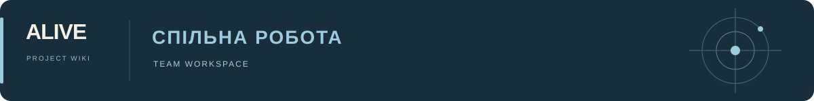

# Визуальный каталог ALIVE

Статичный сайт: [World](https://esannikov.github.io/Alive/World/). Подключены Таис, [Эмма](https://esannikov.github.io/Alive/World/characters/emma/), Федор, [Колька](https://esannikov.github.io/Alive/World/characters/kolka/) и [Моаг](https://esannikov.github.io/Alive/World/ships/moag/). Новые материалы корабля публикуются в World/ships/moag/. У локаций и других результатов пока нет выдуманных галерей.

## Замечания продюсеров

[Уточнение Донов и Эммы](Don_Emma_Refinement_2026-10-26.md) — рука-оружие, две птицеобразные версии и пропорции лица.

[Внесённые визуальные правки](Feedback_Fixes_2026-10-26.md) — Валёк, Эмма, Дон-15 и ответы в обсуждениях.

[Разбор отзывов от 26 октября 2026](Producer_Feedback_2026-10-26.md) — предпочтения, задачи на правку, разногласия и исключённые варианты; [полные сообщения](Producer_Feedback_2026-10-26.json).


## Источники

- [asset_codes.json](asset_codes.json) — постоянные коды, оригинальные файлы и контрольные суммы. Коды не назначаются заново при сборке.
- [objects.json](objects.json) — страницы объектов, серии, производные и связи с задачами.
- [research_plan.json](../research_plan.json) — полный состав работ и ProductionFlow.
- [Дизайн](DESIGN.md) — утверждённая визуальная система и особенности первого выпуска.

Активных изображений: 138. Всего записей в реестре: 227; вне активных подборок: 89. Актуальные коды и видимость указаны в [реестре](asset_codes.json). Это поисковые варианты; наличие файла не означает выбора или принятия полного комплекта. Будущие производные видны как неактивные вкладки. Комментарии подключаются отдельно через Giscus; кнопок принятия дизайна и записи в GitHub Issues нет.

## Сборка и проверка

```sh
python3 scripts/build_world.py
python3 scripts/build_production_flow.py
python3 scripts/validate_world.py
python3 scripts/validate_roadmap.py
python3 scripts/validate.py
```

Сборщик использует Python stdlib и `cwebp` для компактных превью, оригиналы остаются неизменными. Шрифты Onest и IBM Plex Mono хранятся вместе со страницами и лицензиями. Шрифты локальные. При включении комментариев загружается Giscus и его GitHub Discussions; источники романа открываются по отдельным ссылкам.

HTML содержит реальные ссылки и все активные изображения, поэтому галереи читаются без JavaScript. JavaScript добавляет переключение серий, просмотр по коду, поиск, сравнение, копирование и увеличение. Он не хранит принятые решения. При включённом Giscus комментарии обрабатываются внешним виджетом и хранятся в GitHub Discussions.

## Коды и обновления

Поисковые кинопортреты персонажей готовятся в горизонтальном 16:9, в сопоставимом среднем/поясном масштабе с существующей галереей. Для каждого персонажа используется одна общая ветка обсуждения; новые варианты добавляются к ней по постоянным кодам. При добавлении изображений в готовый шаблон достаточно проверить сами файлы, формат, привязку кодов и публикацию; полный повторный прогон интерфейса нужен при изменении его логики.

Код обозначает изображение/концепт и остаётся постоянным. Для нового художественного варианта — следующий свободный код. Перестановка, смена имени файла или повтор в другой подборке не меняют код. Уменьшенное превью — версия отображения того же материала, а не новый концепт. Оригинал, точные дубликаты и производные превью описываются раздельно. Ссылка «Оригинал» закреплена за исходным коммитом, поэтому последующая замена файла в другой галерее не подменяет изображение под уже присвоенным кодом.

Перед добавлением изображения проверить хеш оригинала, назначить код, обновить объект и выполнить сборку. Если существующий оригинал изменён по тому же пути, сборка остановится на несовпадении хеша; нельзя обходить это заменой контрольной суммы старого концепта. У новой творческой версии должен быть новый код и, когда отношение известно, заполненная связь `derived_from`.

Прямые ссылки: `World/characters/tais/#tais001`, `World/ships/moag/#moag003`. Все ранее присвоенные коды должны продолжать открывать тот же оригинал. При подключении новых объектов префиксы согласуются с реестром и не переиспользуются.

## Связь с ProductionFlow

В справке персонажа — точные переходы к внешности, костюмам, мимике и состояниям. Моаг связан с задачей `hull`. Карта поддерживает адрес `ProductionFlow/#task=fedor` и показывает обратные переходы к объектам. Одна задача может иметь несколько персонажей; один персонаж связан с несколькими задачами. Появление портретов не завершает задачу модельного листа.

Общая карта и подробный источник объёма сохраняются. Статусы выполнения или принятия не выводятся из количества изображений.

## Проверка перед публикацией

Проверены существование и хеши всех оригиналов, уникальность кодов и HTML-якорей, внутренние ссылки, лицензии, соответствие данным плана. Браузерная проверка должна дополнительно покрыть точный поиск, глубокую ссылку в прежнюю серию, историю переходов, сравнение, увеличение, копирование, телефон и версию без JavaScript.

Убранные из подборки материалы не отображаются в галерее, сравнении и поиске. Прямая ранее выданная ссылка продолжает показывать именно прежний файл с пометкой об исключении; она не возвращает его в текущую подборку.

## Качество просмотра

Большой просмотр, сравнение и увеличение используют исходные изображения во всех галереях. Миниатюры создаются шириной 640 px с качеством WebP 92. В галерее Моага все 18 вариантов доступны через постоянную сетку миниатюр; у выбранного варианта есть кнопки доступных ракурсов. Исходные файлы и их коды не меняются.

Кадры `moag005` и `moag009` удалены по запросу пользователя вместе с текущими файлами и превью. Коды зарезервированы в `deleted_codes` и повторно не назначаются. `moag006` и `moag010` сохраняют прежние коды и подписи. Клик по миниатюре корабля открывает изображение поверх галереи; после закрытия положение страницы сохраняется; новый оригинал показывается после декодирования, до этого виден индикатор загрузки.

Регрессионная проверка переключения: `node scripts/test_world_gallery.cjs` при запущенном локальном сервере `docs/` и доступном Playwright. `WORLD_BASE_URL` задаёт адрес World, `CHROME_BIN` — путь к Chromium. Тест задерживает ответы, проверяет сохранение прокрутки, отсутствие старого кадра, быстрый повторный выбор, ошибку сети и повторную загрузку.

Для просмотра оригиналы загружаются непосредственно с World по локальным адресам публикации. Ссылка «Оригинал» сохраняет закреплённый адрес исходного коммита. Размер и байты исходных изображений не изменяются.

Эмма: `emma001`–`emma006`, шесть поисковых портретов до побега. [Опоры и трактовка](Emma_Concepts_2026-10-24.md), [промпты](emma_concept_prompts.json). Галерея связана с `emma` и `character-concepts`; общий поиск героинь также ведёт к Таис. Наличие портретов не меняет статус модельного листа.

Колька: `kolka001`–`kolka006`, шесть ранних поисковых портретов. [Разбор источников](Kolka_Concepts_2026-10-24.md), [промпты](kolka_concept_prompts.json). Галерея связана с задачей `kolka`; статус модельного листа не изменён.

## Размерный лист роботов

[Рабочая шкала](https://esannikov.github.io/Alive/World/robots/scale/) — отдельное исследование, не галерея принятых дизайнов. [Данные](robot_scale_study.json) отделяют относительные сведения романа от численных предложений. Сначала запустить `python3 scripts/build_robot_scale.py`, затем `python3 scripts/build_world.py`. Исследования в `objects.json: studies` подключаются к обзору, каталогу и Flow; задача `scale` и задачи роботов ведут на лист. Рост людей тоже условный. Статусы плана не изменены.

Лон: [галерея](https://esannikov.github.io/Alive/World/robots/lon/), [описания и направления](Lon_Concepts_2026-10-24.md), [промпты](lon_concept_prompts.json). Активны `lon001`–`lon004`, `lon007`, `lon009`, `lon010`. Прежние `lon005`, `lon006`, `lon008` доступны только по старым кодам и не входят в актуальную подборку. Публикация связана с задачей `lon`; размерный лист сохранён отдельным исследованием.


Пробы Федора с референсом и резерв лиц: [обновление 24 октября](Conrad_and_Reserve_2026-10-24.md). Код `emma006` перенесён в «Девочки с базы» без изменения изображения; прежняя ссылка из галереи Эммы перенаправляется к тому же материалу в резерве.

Дон-15: [галерея](https://esannikov.github.io/Alive/World/robots/don15/), коды `don001`–`don006`. [Направления и опоры](Don15_Concepts_2026-10-24.md), [промпты](don15_concept_prompts.json). Шесть полнофигурных концептов связаны с задачей `don15`; критерии приёмки и статусы плана не изменены.

Цвет Дона-15: активные `don013`, `don014`, `don003`, `don004`, `don015`, `don006`; три тёмных и три светлых. `don001`, `don002`, `don005` выведены из текущей подборки с сохранением файлов. Промежуточные цветовые пробы 007–012 не опубликованы, эти номера не переиспользовать.

Доспешные направления Дона-15: `don016` Готика, `don017` Клюв, `don018` Милан, `don019` Ламелла. Они добавлены к прежним шести: в галерее десять актуальных концептов.

Мартин: [галерея](https://esannikov.github.io/Alive/World/robots/martin/), [опоры и направления](Martin_Concepts_2026-10-25.md), [промпты](martin_concept_prompts.json). Активные коды: `martin001`–`martin004`, `martin006`, `martin008`. Связь с Flow: `robotfamilies`. Квадратный `martin005` и ранний пастельный `martin007` сохранены вне активной подборки.

Валёк: [галерея](https://esannikov.github.io/Alive/World/characters/valek/), `valek001`–`valek006`. [Опоры в романе](Valek_Concepts_2026-10-25.md), [промпты](valek_concept_prompts.json). Связан с `support` в Flow. Показан здоровый образ до болезни; статусы плана сохранены.

Валёк: после правки масштаба головы и торса активны `valek007`–`valek012`. Предыдущие шесть файлов сохранены с прежними кодами вне текущей подборки.

Нитка: [галерея](https://esannikov.github.io/Alive/World/characters/nitka/), `nitka005`–`nitka011`: шесть типажей и рабочий кадр на основе C, все в 16:9. Вертикальные `nitka001`–`nitka004` сохранены вне активной подборки. [Опоры и происхождение](Nitka_Concepts_2026-10-26.md), [промпты](nitka_concept_prompts.json). Связана с `support`; выбор типажа открыт, резервный `emma006` сохранён.

## Комментарии

[Настройка Giscus](Comments_Setup.md), [конфигурация](comments.json). Включение допускается только с реальным ID категории Comments и установленным приложением. Код добавляет отдельное обсуждение к каждой странице, не меняя выбранный кадр галереи.

Маша: [галерея](https://esannikov.github.io/Alive/World/characters/masha/), шесть типажей `masha001`–`masha006` в 16:9. [Опоры в романе](Masha_Concepts_2026-10-26.md), [промпты](masha_concept_prompts.json), [общая ветка обсуждения](https://github.com/esannikov/Alive/discussions/50). Связь с задачей `support`; типаж ещё не выбран.

Катя: [галерея](https://esannikov.github.io/Alive/World/characters/katya/), шесть типажей `katya001`–`katya006` в 16:9. [Опоры в романе](Katya_Concepts_2026-10-26.md), [промпты](katya_concept_prompts.json), [общая ветка обсуждения](https://github.com/esannikov/Alive/discussions/67). Связь с задачей `support`; типаж ещё не выбран.

Илья: [галерея](https://esannikov.github.io/Alive/World/characters/ilya/), шесть типажей `ilya001`–`ilya006`. [Опоры и кастинговые направления](Ilya_Concepts_2026-10-27.md), [промпты](Ilya_2026-10-27_prompts.json). Связь с задачей `support`; вариант не выбран.

Соня: [галерея](https://esannikov.github.io/Alive/World/characters/sonya/), шесть типажей `sonya001`–`sonya006`. [Опоры в романе](Sonya_Concepts_2026-10-27.md), [промпты](Sonya_2026-10-27_prompts.json). Связь с задачей `support`; типаж ещё не выбран.

Егор: [галерея](https://esannikov.github.io/Alive/World/characters/egor/), шесть типажей `egor001`–`egor006`. [Опоры в романе](Egor_Concepts_2026-10-27.md), [промпты](Egor_2026-10-27_prompts.json). Связь с задачей `support`; типаж ещё не выбран.

Жанна: [галерея](https://esannikov.github.io/Alive/World/characters/zhanna/), шесть типажей `zhanna001`–`zhanna006`. [Опоры в романе](Zhanna_Concepts_2026-10-27.md), [промпты](Zhanna_2026-10-27_prompts.json). Связь с задачей `support`; типаж ещё не выбран.

Рита: [галерея](https://esannikov.github.io/Alive/World/characters/rita/), шесть типажей `rita001`–`rita006`. [Опоры и открытый вопрос о возрасте](Rita_Concepts_2026-10-27.md), [промпты](Rita_2026-10-27_prompts.json). Связь с задачей `support`; типаж ещё не выбран.
