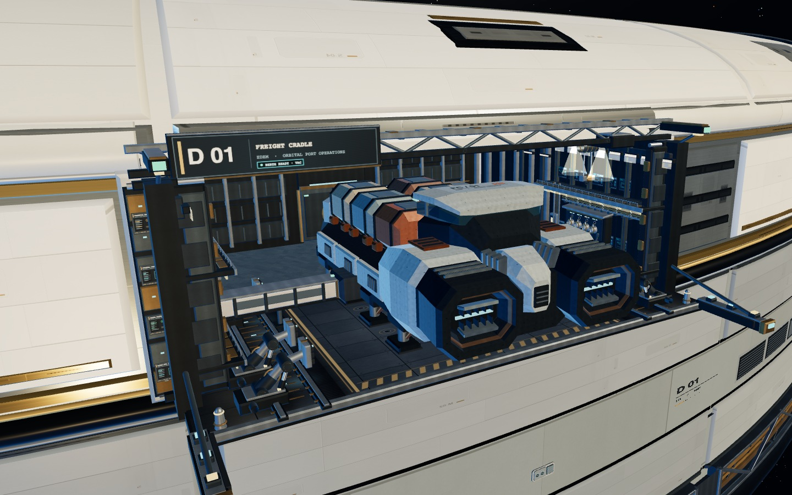

# Edem · добовий звіт за 25–26 листопада 2026

Робоче вікно охоплює 25 листопада та нічну підготовку релізу 26 листопада за Києвом. Джерела для змін Неона — датовані записи в архітектурному плані, звіт першого етапу й фактичний вміст авторської збірки. Попередня публічна версія станції датована 24 листопада. [Журнал моделі](agent/PLAN.md) · [Попередня збірка](https://github.com/esannikov/Alive/tree/6b50484ba69ed4a651a698731821c16a02d7376a/docs/StationModel)

## Що змінилося в станції

| Де дивитися | Що можна побачити |
|---|---|
| [З орбіти](https://esannikov.github.io/Alive/StationModel/station-3d.html#view=orbit) | Перлинний житловий пояс відділяє верхній титановий ярус від темних технічних палуб. На стику B2–B3 з’явилися консольні ферми й зовнішні модулі відведення тепла, на короні купола — телеметричні вузли. Перебудовано зоряне поле, відбиття Землі та орбітальне світло. |
| [Верхній порт](https://esannikov.github.io/Alive/StationModel/station-3d.html#view=dockDetail) | У D01 і D02 видно приймальні камери, напрямні, посадкові переходи й обладнання причалів. Трансферний човник D02 і вантажні шатли B2 мають споріднені кожухи рушіїв. На III рівні деталізовано робочі сектори, а над ним — антенний шпиль. |
| [Пультова Ангару 2](https://esannikov.github.io/Alive/StationModel/station-3d.html#view=dispatchRoom) | Пультову й лабораторію перенесено до зовнішнього борту. Від внутрішнього містка веде поперечний перехід. У пультовій можна відкрити шторку й побачити Землю, як в епізоді на с. 532. В ангарах 1 і 3 додано контейнерні двори, стелажі й настили. |
| [Нижній рівень](https://esannikov.github.io/Alive/StationModel/station-3d.html#view=familyRefuge) | В укритті Овальних з’явилися побутові речі й накритий стіл. У покинутих каютах — шафки, полиці та освітлення. Уточнено стик біля Квадратного колодязя, підходи через вентиляцію та обладнання майданчиків вантажної шахти. |
| [Сюжетний епізод 07](https://esannikov.github.io/Alive/StationModel/station-3d.html#story=07) | Після Променевої печі маршрут приводить на круглий майданчик III рівня до Дона-15. Сюжет має 19 епізодів. Місце книжкової події на с. 110–112 і штатний ремонтний пост D1 мають окремі ракурси. |

## Важкий транспортник MOAG-FC01

Крейсери в романі приходять за програмою. Художня адаптація для D01 показує, що саме перевозить такий корабель і як його обслуговують. Шість герметичних касет стоять у двох рядах. Темні пояси касет спускаються до охристих замків. Нижні силові балки передають навантаження на вісім опор. Місток піднятий над вантажем, а кормові рушії рознесені по боках кіля. На стоянці в глибині кожного каналу видно вузьку смугу чергового світла. [Книжковий орієнтир, с. 486](https://github.com/esannikov/Alive/blob/main/Sources/Novel.md#сторінка-486) · [Транспортник у доці](https://esannikov.github.io/Alive/StationModel/station-3d.html#view=cruiser)

Корабель побудовано в авторському модулі Three.js `source/src/architecture/freightCruiser.js`. Геометрію дрібних деталей об’єднано за матеріалом. Під час розстановки використано чинний масштаб доку; висота опор задана від місцевої палуби. Бортовий шлюз поставлено навпроти кінцевої секції посадкового переходу. Ракурс відкриває кормову чверть і вантажний ряд за містком.

## Що виявлено під час перевірки

- Перехід за другим посиланням на сцену у відкритій вкладці змінював лише адресу. Навігатор тепер обробляє зміну фрагмента URL та завершує попередній автоматичний маршрут.
- Підказка кнопки «Сюжет» та атлас камер відставали від маршруту. Кнопка бере кількість епізодів із даних. В атласі тепер 19 епізодів і 237 камер. [Атлас](agent/CAMERAS.md)
- У каталозі залишалися попередні зображення обігрівача A-01 та дверей A-06. Мініатюри заново відрендерено з тих самих GLB, які відкриває переглядач. [Каталог](https://esannikov.github.io/Alive/StationModel/model-library.html)
- Уточнено службові матеріали агента, зокрема рішення про тяжіння та джерело енергії, карту модулів і дані оновлених моделей. [Довідник](STATION_AGENT_GUIDE.md)

## Перевірка релізу

Зібрано автономний HTML із перевіркою посилань між камерами, мітками та ярусами. Звірено маніфест і заголовки всіх 304 файлів GLB. До каталогу входять 282 базові Blender-моделі й 303 їхні стани та пози. Окремий GLB використано для павільйону набережної.

У Chrome перевірено D01, D02, майданчик Дона, фонтан, пультову, Мисливську шахту й орбіту, перехід між епізодами, кнопку «Далі» в екскурсії та відкриття моделі з каталогу. Перевірка охоплює вибрані сцени на настільному комп’ютері. Плавність на слабкому GPU та роботу в мобільному Safari слід виміряти окремо.
