# ALIVE · Фотореалістичний стиль v1.1

15.11.2026. Пакет на погодження; грудневий довідник доповнюється окремо.


## Що подається на погодження

ALIVE Photorealism v1.1, 15 листопада 2026. Єдиний робочий стандарт для фотореалістичних концептів персонажів, роботів та середовища. Концепти взято з готових матеріалів; шість об’ємних схем світла створено внутрішнім imagegen. Погодження документа не затверджує автоматично кастинг, конструкцію станції або всі включені концепти.

Просимо погодити базову фотографічну мову, порядок постановки й перевірки кадру та склад контрольних матеріалів. Числові рецепти схем світла, палітри й плівкові тести нижче є виробничими пропозиціями v1.1, а не вимірами прийнятих зображень.

Результат трекера | Наявне у v1.1 | До грудня
--- | --- | ---
MAT-R030 · Загальний довідник | Цей пакет, еталони, процес, промпти | Затвердити й доповнити після тестів
MAT-R033 · Форма й пропорції | Правила масштабу, силуету, віку | Порівняльні листи ядра
MAT-R034 · Збереження стилю | Опубліковані приклади; протокол перевірки | Контрольована матриця повторюваності
MAT-R035 · Малі деталі | Карта шкіри, волосся, тканин і стиків | Макролист деталей середовища
MAT-R036 · Матеріали | Класи фактур та існуючі приклади | Єдина сфера/площина під одним світлом
MAT-R037 · Палітри | Ролі кольорів; запропоновані проби | Погоджені палітри локацій
MAT-R038 · Освітлення | Шість схем і порядок налаштування | Прогони на контрольних сценах
MAT-R039 · Стара/нова техніка | Правила читання поколінь | Парні листи однакових вузлів
MAT-R040 · Знос і ремонт | Рівні зносу, причинність, приклади | Погоджений атлас пошкоджень

Листопад: погодити основу та уточнення до неї. Грудень, KPP-R257: підтвердити її відтворюваність і завершити спеціалізовані атласи. Подання v1.1 не означає виконання всіх грудневих тестів.


## Статуси та походження

Позначка | Що означає
--- | ---
Зафіксований принцип | Прийнятий Євгеном робочий підхід від 09.11.2026: нова фотографічна постановка, обличчя, оптика й мотивоване світло.
Наявний приклад | Файл уже створений і опублікований. Він ілюструє конкретну ознаку, але не є автоматично прийнятим дизайном.
Пропозиція v1.1 | Нова систематизація, схема або числовий старт для виробничої проби. Потребує перегляду.
Грудневий тест | Перевірка або атлас, яких цей пакет ще не підтверджує.

Книжкові факти беруться з чинного Sources/ALIVE.pdf і текстового витягу Sources/Novel.md; Bible/Visual_Development.md дає тематичні опори. Конкретна форма обличчя, крій, відтінок стіни, оптика та постановка світла залишаються рішеннями розробки, якщо джерело не задає їх прямо.

- Власний код зображення та SHA-256 зв’язують приклад з незмінним оригіналом. Зображення у PDF - лише представлення; байти джерел збережені в пакеті окремо.
- Для кожного промпта зазначено: точний архівний текст чи новий шаблон. Промпти різних серій не підміняють один одного.
- Референс обличчя задає особистість; референс світла задає світлову логіку. Не переносити випадкові риси одного референсу в іншу задачу.
- Відсутні seed, точна модель старого вбудованого imagegen або реальні EXIF не вигадуються. Плівка й фокусна в текстовому запиті не доводять фізичної симуляції.

Додаток містить точні промпти п’яти існуючих прикладів, реєстр восьми зображень, контрольні суми та зовнішні технічні джерела. Об’ємні схеми L1–L6 створено внутрішнім imagegen; їхні промпти збережено окремо.


## Опорний кадр: Іра та Жанна

Спільний ключ, м’яке заповнення й узгоджений фокус на обох обличчях.

- У точному промпті: еквівалент 75 мм, f/5.6, обидва обличчя поблизу однієї дистанції фокуса; це опис вигляду, не EXIF.
- Холодно-нейтральне віконне світло, обмежений теплий робочий акцент, слабке відбиття й контроль тіньової сторони.
- Не накопичувати ретуш поверх воскового обличчя: перебудувати новий кадр з тією самою логікою світла. Впізнаваність перевірити окремо. Опорний v7 створювався без вхідних зображень.


## Перевірка на різних обличчях

Природна шкіра, збережений вік і виразний характер у різних типажів.


## Побутова сцена та кілька облич

Зустрічні погляди, природні жести й контакт рук із реквізитом.


## Світло: порядок постановки

Позначення на схемах: KEY - ключове світло; BOUNCE - відбивач; FLAG - чорний прапор; PRACTICAL - лампа в сцені; CAMERA - камера.

Спершу назвати видиме або логічно можливе джерело: вікно, стельова панель, робоча лампа, екран. Потім визначити напрям, відносний розмір, м’якість, колір і роль. Формулювання «cinematic lighting» без цих ознак не є схемою.

- 1. Вимкнути умовні заповнення. Поставити ключове світло так, щоб читалися очі й площини обличчя.
- 2. Додати слабке відбиття від столу чи стіни лише там, де воно фізично мотивоване.
- 3. Послабити небажане відбиття чорним екраном (negative fill). Це прибирає світло, а не додає чорний контур.
- 4. Відокремити фон вибірковим практичним джерелом або різницею тону; контрове світло не обов’язкове.
- 5. Перевірити тінь носа, контактні тіні, відблиски очей і металу. Усі повинні відповідати одному розташуванню джерел.

Параметр | Як фіксувати
--- | ---
Напрям | Азимут від осі камери та висота над очима; схема зверху плюс опис висоти.
М’якість | Видимий розмір джерела з позиції героя. Велике близьке джерело дає ширший перехід тіні.
Різниця експозиції | ΔEV = log2(Ekey / Efill) для окремо виміряних внесків. 1 стоп = 2:1; 2 стопи = 4:1.
Неоднозначність ratio | Відношення окремих джерел не дорівнює відношенню освітленої й тіньової щоки, де внески змішуються.
Колір | Температура джерел плюс баланс білого камери. Саме Kelvin без WB не задає колір зображення.

Діапазони наступних шести схем - стартові пропозиції ALIVE. Вони не виміряні на генераціях. У фізичній сцені/3D потрібна контрольна карта та вимір; у генерації - візуальний перегляд. Загальні терміни звірені з ARRI Lighting Handbook [T1].


## L1 · Нейтральний портрет

Одна людина; паспорт зовнішності

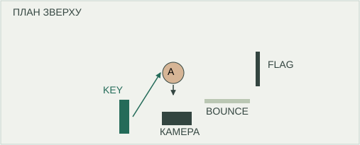

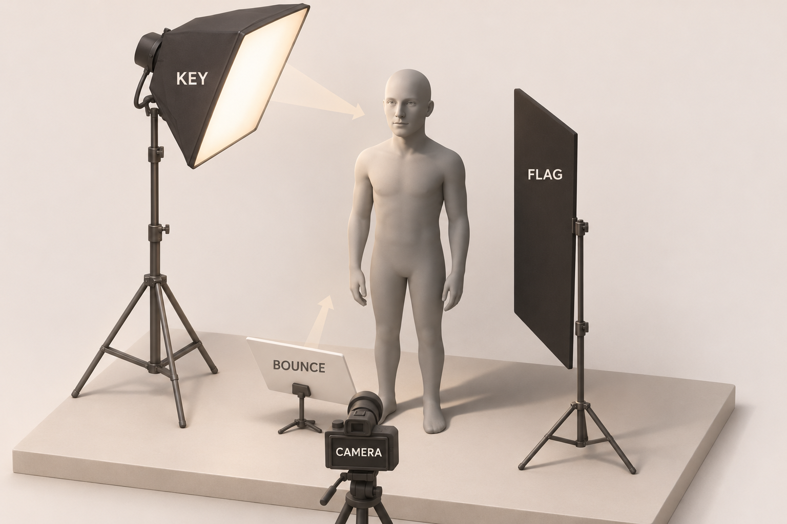

Ключ: велика м’яка панель ліворуч від камери, 35–50° убік, 15–30° вище очей. Початковий орієнтир 4800–5600 K, WB близько 5000 K. Світла поверхня нижче обличчя дає слабке відбиття; чорний екран справа зменшує заповнення.

Почати з окремого внеску fill на 1.5–2.5 стопа нижче key. Фон за обличчям приблизно на 0.5–1.5 стопа темніший за середній тон шкіри, але не суцільно чорний. Ці відношення підбираються під тон шкіри й сцену.

Розслаблений або заданий характером рот; погляд на партнера біля об’єктива. Верхівка й волосся з запасом близько 10% висоти. Базовий орієнтир 65–85 мм еквівалента, f/4–5.6; обидва ока в зоні різкості.

Помилка: рівномірна підсвітка вбиває об’єм; жорсткий блік по всій щоці робить шкіру пластиковою. Спершу змінити джерело й заповнення, потім деталізацію.


## L2 · Діалог у майстерні

Дві людини; обмін поглядами

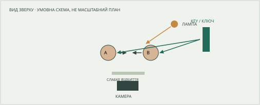

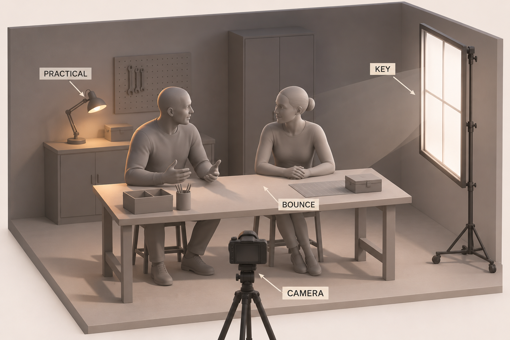

Ключ: широке вікно справа від кадру, поперек обох облич. Персонажі повернуті один до одного, їхні очі близькі за дистанцією до камери. Тепла робоча лампа позаду додає локальний акцент; стіл - слабке відбиття.

Пропозиція: key 5000–6000 K; practical 2800–3400 K; WB 4300–5000 K. Почати з fill на 1.5–2 стопа нижче key. Теплий акцент не повинен забарвлювати весь контур обох голів.

65–75 мм еквівалента і f/5.6 як старт; відсунути камеру настільки, щоб обидва герої природно входили в середній план. Якщо одна людина помітно далі - змінити блокування або глибину різкості.

Помилка: незалежний світловий портрет для кожного обличчя створює колаж. Перевірити напрям тіней і однакову логіку відблисків. Принцип відповідає ira007; схема - реконструкція для роботи, не вимір кадру.


## L3 · Технічний прохід

Тісний простір, рух, настороженість

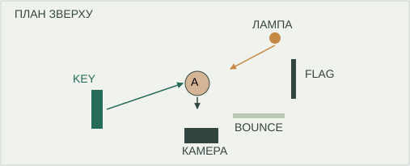

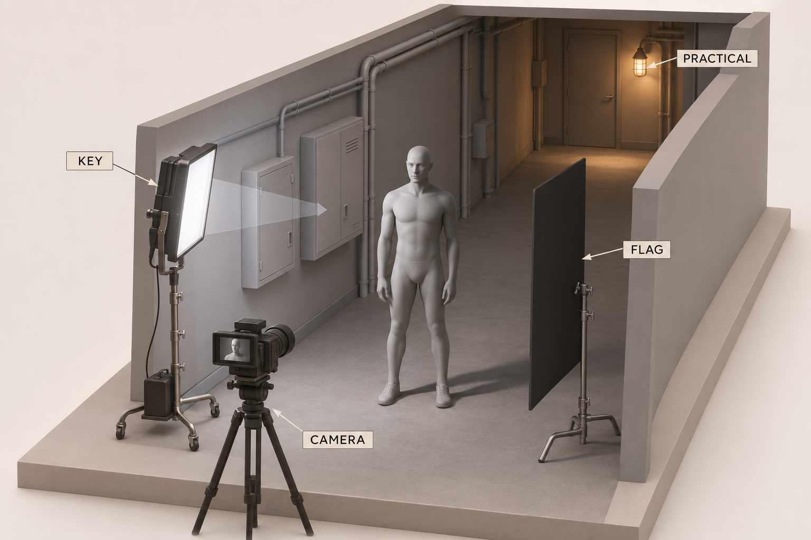

Ключ мотивований сервісною панеллю збоку й трохи попереду героя. Стельові лампи задають ритм проходу, але не створюють однаково яскравий тунель. Поставити чорний екран з протилежного боку; зберегти слабкий рефлекс стін.

Пропозиція: key 4000–5000 K, віддалена робоча лампа 2800–3200 K. Fill на 2–3 стопи нижче key; зберегти око на тіньовій стороні. Не піднімати загальний чорний рівень заради читабельності.

35–50 мм для героя в середовищі; 50–65 мм для поясного плану. Камера на рівні дії; широке скло близько до обличчя не використовувати для кастингового порівняння. Двері й труби залишаються геометрично правдоподібними.

Помилка: туман, жовті смуги та мокра підлога з’являються автоматично як декорація. Додавати їх лише за сценою. Відокремлювати героя композицією, а не обов’язковим неоновим обводом.


## L4 · Оранжерея

Дифузне світло, рослини й люди

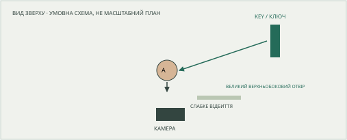

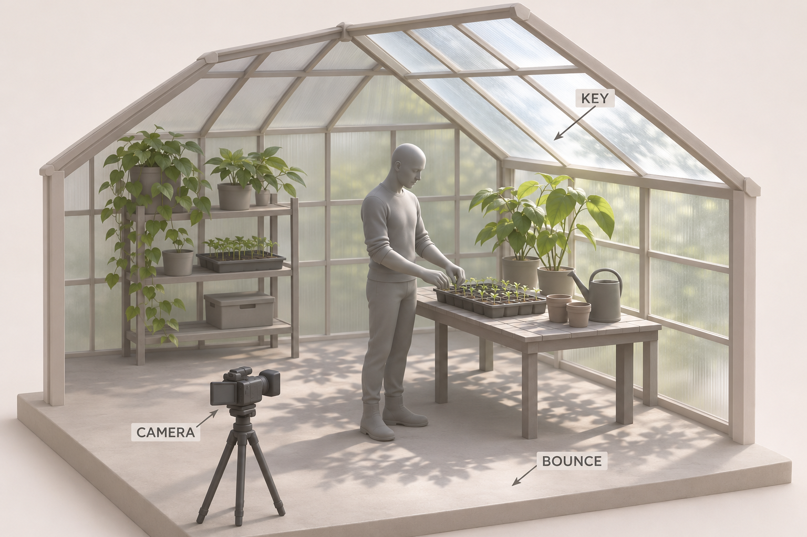

Великий верхньобоковий світловий отвір формує м’які площини. Частина світла проходить між листям; рисунок на обличчі стриманий. Заповнення - від підлоги та світлих конструкцій. Зелений рефлекс локальний, не загальний фільтр.

Пропозиція: ключ 5000–6500 K, WB 5000–5600 K. Fill на 0.5–1.5 стопа нижче key. Листя має діапазон матових і слабко блискучих поверхонь; світлі ділянки не зливаються з білими панелями.

35–50 мм для середовища, 65–85 мм для обличчя. Достатня глибина різкості для руки, інструмента й рослини в одній дії. Не робити кожну жилку кожного листка однаково різкою.

Помилка: декоративні джунглі замість робочої оранжереї. Зберігати проходи, доступ до розсади, положення роботів і контакт інструментів. Це схема для майбутнього тесту, не завершений світловий паспорт локації.


## L5 · Теплий побутовий простір

База, розмова, близькість без гламуру

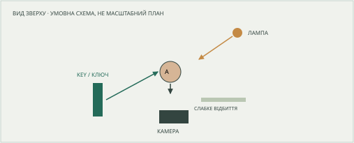

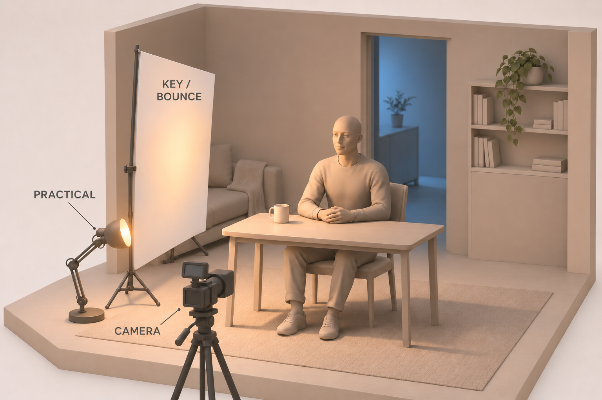

Ключ: велике відбиття від теплої настільної/стінної лампи. Лампа в кадрі пояснює світло, але не повинна бути єдиним маленьким жорстким джерелом на обличчі. Холодніший слабкий світловий прохід відділяє дальній план.

Пропозиція: key 3000–3800 K, WB 3600–4200 K, фонова домішка 4500–5500 K. Fill на 1–2 стопи нижче key. Тепло має зберігати різницю між шкірою, деревом, тканиною та металом.

50–75 мм для спокійної розмови; f/4–5.6 як старт. Відмова від модельної пози, читабельний побутовий жест, природні складки одягу. Предмети зношені відповідно до використання.

Помилка: весь кадр стає бурштиновим або шкіра помаранчева. Відновити нейтральні опори, знизити домінування практичного джерела, не лікувати сцену глобальним холодним фільтром.


## L6 · Робот і матеріал

Форма, механіка, поверхня

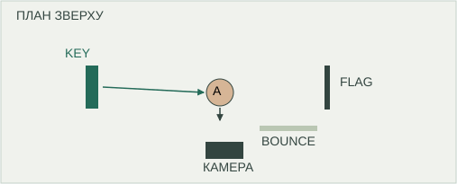

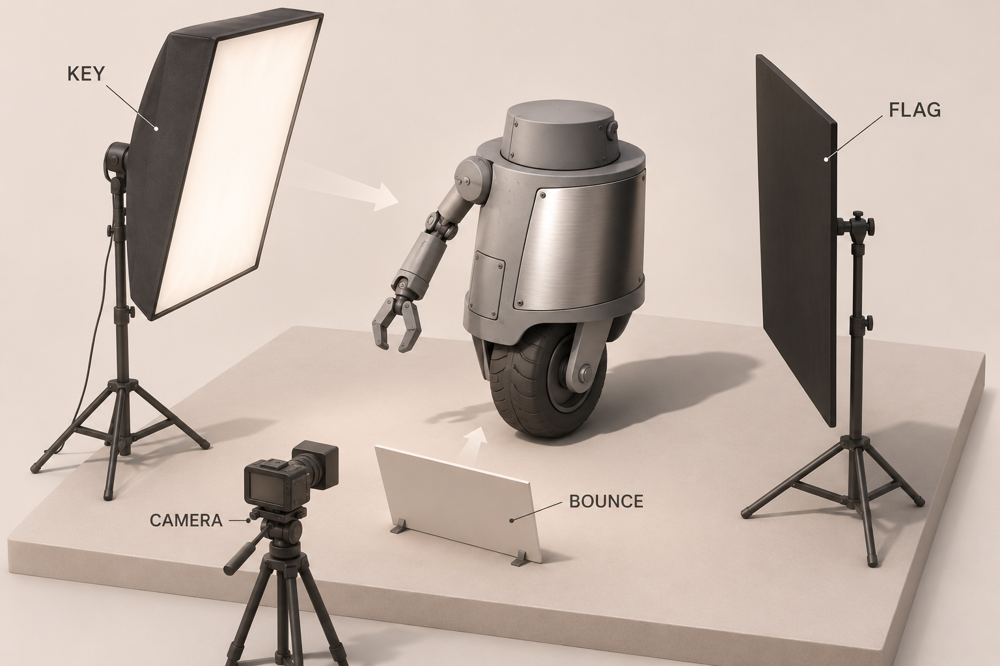

Ключ: довга велика панель збоку, її відбиття описує кривизну металу. Протилежний чорний прапор дає контрольовану темну смугу. Малий акцент можна направити на потрібний вузол, не перетворюючи всі ребра на білі лінії.

Пропозиція: нейтральний ключ 5000–5600 K, нейтральний WB; fill на 1–2 стопи нижче key. Окремо зберегти світлий пластик, оголений метал, гуму й фарбовані панелі. Блік не є текстурою матеріалу.

50–85 мм для порівняння форми; 85–105 мм як орієнтир на деталь. Повний силует, масштабна опора, видимий контакт із підлогою. Кисті й інструменти показувати в однозначній дії.

Помилка: блискучий «дорогий» рендер приховує функцію. Спершу перевірити кількість опор, шарніри, захват, доступ для ремонту та масштаб; лише потім поверхню.


## Оптика та перспектива

У цьому пакеті фокусні наведено як приблизний еквівалент кута огляду для повного кадру 36 мм завширшки. Для іншого сенсора треба зафіксувати його розмір. Перспективу визначає точка зйомки; зміна фокусної з тієї самої точки переважно змінює охоплення. «Довгофокусне стискання» зазвичай пов’язане також із віддаленням камери.

Задача | Стартовий орієнтир | Контроль
--- | --- | ---
Середовище з людиною | 28–40 мм | Не наближати обличчя до краю й камери; стежити за масштабом кінцівок.
Поясний план / дія | 40–65 мм | Руки, предмет і обличчя не розпадаються на різні просторові плани.
Кастинговий портрет | 65–85 мм | Нормальна дистанція, обидва ока й ніс читаються; однаковий масштаб між пробами.
Діалог двох | 50–75 мм; f/4–5.6 | Перевірити обидві дистанції фокуса; не покладатися на число діафрагми саме по собі.
Деталь вузла / тканини | 85–105 мм; f/5.6–8 | Чітко задати площину й масштаб деталі, не називати все «macro».

- f-number описує геометричну діафрагму, T-stop враховує пропускання світла. Не записувати f/5.6 і T5.6 як виміряно тотожні значення.
- Глибина різкості залежить від формату, дистанції, фокусної, діафрагми та критерію перегляду. Конкретна сцена важливіша за універсальне «f/1.4».
- Вхідний референс має містити повну голову; для портретних проб залишати близько 10% запасу над волоссям, якщо композиція не вимагає іншого.
- Для порівняння віку/типажу фіксувати ракурс, дистанцію, масштаб голови, світло та вираз. Зміна всіх параметрів одночасно приховує результат.

ARRI пояснює зв’язок формату сенсора, кута огляду й глибини різкості [T2]. Таблиця вище - робочі пропозиції ALIVE, не специфікація обладнання.


## Експозиція та керування кольором

- Реальна зйомка/3D: зафіксувати сенсор або камеру, EI/ISO, діафрагму, витримку, WB, колірний простір і перетворення перегляду. Перевірити нейтральну карту, фактичне кліпування й яскраві матеріали.
- Генеративний PNG/WebP: це вже сформоване зображення. Не приписувати йому RAW, LogC, лінійний ACEScg або запас експозиції, яких файл не містить. Перевірити ICC-профіль; якщо він відсутній, прийняте трактування записати як припущення, не як факт.
- Не застосовувати LUT для LogC без правильного вхідного перетворення до звичайного sRGB-зображення. Подвійний display transform дає неправильний контраст і колір.
- Для web-копії пропонується sRGB; для відео вихід погоджується окремо. Оригінал зберігається без конвертацій, grade - новою похідною версією.
- Для реального ACES-процесу фіксуються версія конфігурації, Input Transform, робочий простір і Output Transform [T3]. Сам напис «ACES» у промпті не виконує цих перетворень.

Перевірка | Прийнятний результат
--- | ---
Світла | На білій кофті є рисунок; відблиск металу не з’їдає форму. Локальне кліпування практичної лампи оцінюється за задумом.
Тіні | Видно око, контакт і матеріал, якщо це потрібна інформація. Не підіймати все до сірого.
Шкіра | Зберігається індивідуальний тон, а не один оранжевий стандарт для всіх.
Нейтралі | Сіра тканина й білий комір допомагають побачити паразитний зелений/пурпуровий зсув.
Серія | Порівнювати під одним перетворенням перегляду; оцінювати не лише гістограму, а й пріоритет обличчя.

Для відеотесту 24 fps і 180° затвора відповідають приблизно 1/48 с: t = angle/(360 × fps). Це запропонований старт, не вже прийнятий режим ALIVE. Статичний кадр не перевіряє motion blur, мерехтіння чи часову стабільність.


## Плівкова подача без декоративного шуму

Базовий master ALIVE залишається чистим: природна шкіра, плавні світла, контрольований контраст. Плівкова подача - окремий варіант для порівняння. У наявних матеріалах немає виміряної або затвердженої емуляції конкретної емульсії, LUT чи зерна.

Напрям тесту | Що просити / перевіряти | Чого не стверджувати
--- | --- | ---
Нейтральний контроль | Чистий master без зерна й дифузії; зберегти пори та колір шкіри. | Що «чистий» означає стерильний або пластиковий.
М’який 35 мм негативний характер | Стриманий контраст, плавні світла, помірна насиченість; без сірого туману в чорному. | Що назва плівки точно відтворює її спектральну відповідь.
Денний орієнтир 250D | Kodak 5207: денний баланс 5500 K, EI 250 [T4]. Використати як довідкову назву тесту. | Що готовий PNG фізично знятий на 5207.
Теплий інтер’єрний орієнтир 500T | Kodak 5219: баланс 3200 K, EI 500 [T5]. Окремо задати джерела та WB. | Що «500T» автоматично означає сильне зерно чи помаранчеву шкіру.

- Grain: дрібна нерегулярна структура у фінальному масштабі, не рівномірна цифрова сітка. Додати лише після схвалення чистого master; оцінити в 100% і розмірі доставки.
- Halation: локальна реакція біля дуже яскравих ділянок, а не червоний обвід кожного контуру. Bloom: м’яке розсіювання світла; не підміняє halation.
- Дифузія: може зменшувати локальний контраст і змінювати яскраві відблиски. Якщо повіки та губи стали восковими - повернути чистий варіант.
- Подряпини, пил і gate weave не додаються як універсальна ознака кіно. Для руху зерно не повинне «приклеюватися» до шкіри чи мерехтіти великими плямами.

Тест F0/F1/F2: той самий вихідний кадр, незмінні кадрування й експозиція; F0 чистий, F1 тільки тональна подача, F2 та сама подача з мінімальним зерном. У рішенні записати вибір і причину. До грудня порівняти щонайменше портрет, темний простір і метал; не оцінювати всі властивості на одному красивому кадрі.


## Обличчя, волосся та мікрофактура

Зона | Потрібна поведінка | Типовий дефект
--- | --- | ---
Лоб і скроні | Тонкий нерегулярний рельєф, невеликі зміни кольору | Однакові великі пори або лакова плівка
Повіки й очі | Тонка шкіра, вологий край, узгоджені зіниці й бліки | Намальована райдужка, два несумісні напрями світла
Ніс / внутрішня щока | Пори трохи помітніші; невеликий природний блиск носа | Блиск покриває все обличчя
Зовнішня щока | Переважно матова, дуже тонкий пушок у вибірковому світлі | Суцільний шум або пісок
Губи | Тонкі вертикальні складки, м’який нерівний край | Глянець і модельний pout
Брови й волосся | Напрям росту, різна густота, пасма з об’ємом | Однакова товщина волосин, пластиковий шолом

- Вік задається пропорціями й м’якими тканинами; підлітка не «дорослішати» щетиною, зморшками або масивною шиєю.
- Розрізняти текстуру шкіри, шум і різкість. Спершу достатня площа обличчя та правильний фокус; додавання пор не відновлює анатомію.
- Веснянки мають нерівномірну густоту й розмір. Зберігати родимки та асиметрії, якщо вони належать обраному обличчю.
- Волосся Кольки: відкритий лоб, підняті рукою пасма, нерівна самостійна стрижка. Уникати салонного fade, гелю й точної «недбалості».
- Обличчя має пріоритет над тканиною та фоном. Надмірна різкість швів поруч із м’якими очима - причина переробки. Не використовувати автоматичний face-restoration як доказ виправленої особистості.

Перевіряти на повному кадрі, потім на оригінальному масштабі обличчя. Збільшення вище 100% не створює нових деталей і не повинно бути єдиним критерієм приймання.


## Матеріали, поверхні та деталі

Матеріал | Ознаки в кадрі | Уникати
--- | --- | ---
Шкіра | Регіональна фактура й різний блиск зон | Одна roughness для всього обличчя
Бавовна / денім | Напрям плетіння за масштабом, шви, складки від навантаження | Гравірованого візерунка на кожному волокні
Трикотаж | Петлі підкоряються розтягненню та формі | В’язаного шуму без конструкції
Фарбований метал | Фарба окремо від основи; сколи там, де є контакт | Срібного контуру на кожному ребрі
Оголений метал | Відбиття описують форму; обробка має напрям | Однакового дзеркала на всіх деталях
Гума | Стискання, матовість, реальні контактні площини | Абсолютно чорної діри без об’єму
Пластик | Товщина, стики, локальні потертості | Кожного пластику як скла
Скло | Край, товщина, відбиття й прозорість | Невидимого бар’єра або суцільного світіння
Рослини | Різна товщина й стан листя; взаємодія зі світлом | Скопійованих глянцевих листків

Ця таблиця систематизує спостереження й правила; це ще не бібліотека PBR-матеріалів. Для 3D потрібні окремі карти й параметри, перевірені в узгодженому рендері. Значення roughness/IOR без конкретного матеріалу, масштабу та шейдера тут не вигадуються.

Показувати робочі стики: кріплення, люки, шарніри, кабельні вводи, ручні шви. Деталь повинна пояснювати складання, доступ, рух або ремонт. Випадкове нагромадження дрібних елементів не робить конструкцію достовірною.


## Матеріали в готових концептах

Тканина й шви читаються за масштабом; метал, шарніри та опори пояснюють конструкцію.


## Форма, масштаб і функція

- Людина: вік, статура, співвідношення голови й плечей, довжина рук, розмір кисті, посадка одягу. Не об’єднувати всіх підлітків у дорослий модельний типаж.
- Робот: спершу силует і задача, потім шарніри, захват і панелі. Кількість рук, опори, висота та спосіб пересування звіряються з описом конкретного типу.
- Станція: проходи, висота дверей, поручні, масштаб людини, доступ для інструмента та ремонту. Кадр повинен витримувати дію, а не тільки виглядати монументально.
- Контакт: підошва торкається підлоги, рука охоплює предмет, вага має опору, тінь узгоджена з контактом. На різних ракурсах не змінюється кількість деталей.
- У масштабній перевірці порівнювати фігури на спільній площині або явно позначати різну дистанцію; перспективний зріст не є виміром.

Біблія дає опори за функцією та середовищем; на сайті вже існує окрема добірка «Персонажі й роботи: масштаб». Використовувати її як суміжний матеріал, не копіювати випадковий зріст із перспективного портрета.

Контрольний лист | Мінімальний склад до грудня
--- | ---
Ядро персонажів | Анфас, 3/4, профіль; однаковий масштаб; узгоджений одяг і вік.
Родина роботів | Спільна лінія підлоги, зріст і габарити, робочі положення, захват.
Локація | План дії, вхід/вихід, масштабна фігура, один контрольний ракурс.
Безперервність | Що може змінюватися між кадрами, а що є інваріантом.

Окремі художні відхилення допускаються лише як підписана пропозиція. Фотореалістична фактура не робить невірну конструкцію або книжковий факт правильними.


## Палітра світу та роль кольору

У джерелах є локальні кольорові й матеріальні опори; завершеної затвердженої палітри всього світу немає. Нижче - стартові групи для тесту, а не канонічні HEX-коди. Цифрові зразки слід погоджувати під єдиним режимом перегляду після вибору локацій.

Середовище | Базові ролі кольору | Стриманий акцент
--- | --- | ---
Доглянутий житловий рівень | Теплі світлі нейтралі, чистий пластик, природна зелень | Особистий предмет або знак
Технічна база | Сіро-сині й графітові тканини, відкритий метал | Локальна тепла робоча лампа
Промисловий простір | Світлі промислові нейтралі, функціональні покриття | Сигналізація за змістом
Оранжерея | Варіативна зелень, ґрунт, нейтральні конструкції | Теплий природний матеріал
Старий вузол | Згаслі кольори фарби, локально оголена основа | Ремонтна деталь іншої партії
Портретне порівняння | Нейтральний фон і спокійний одяг | Шкіра, очі, волосся героя

- Колір і матеріал оцінювати окремо: теплий ключ не робить сірий метал коричневою фарбою.
- Не фарбувати весь світ у teal-orange. Тепле/холодне розділення має джерело й драматургічну функцію.
- Шкіра зберігає природні відмінності; не вирівнювати всіх до одного відтінку.
- Колір сигналу, форми або емблеми звіряється з джерелом і реєстром знаків; декоративний grade не змінює значення.
- Для затвердження зібрати нейтральний кадр, денний/робочий режим і напружений режим кожної ключової локації; додати матеріальні зразки.


## Покоління техніки, знос і ремонт

Стан | Що повинно читатися | Приклад причини
--- | --- | ---
N0 · нове/доглянуте | Чисті стики, послідовна обробка, справні кріплення | Регулярний догляд
N1 · використане | Локальний блиск хватів, потерті краї у місцях контакту | Руки, взуття, інструмент
N2 · відремонтоване | Заміна вузла, латка, інша партія фарби, доступний кріпильний шов | Видима історія обслуговування
N3 · пошкоджене | Деформація, тріщина, оголена основа за конкретною подією | Удар, перегрів, тертя
N4 · занедбане | Забруднення накопичується у захищених місцях; стан впливає на функцію | Тривала відсутність догляду

Ці рівні - пропозиція маркування, не твердження, що вся станція занедбана. Доглянуті житлові приміщення й нові вузли можуть бути чистими. Старе не обов’язково брудне; нове не обов’язково блискуче.

- Стара/нова техніка відрізняється системою складання, сервісним доступом, кріпленням і поколінням вузлів, а не лише подряпинами.
- Ремонт повинен мати виконавця й інструмент: ручний шов, латка, зварний стик, змінний модуль. Не розкидати безпричинні шрами по всій поверхні.
- На одязі протирання відповідає суглобам, хватам і опорам; складка визначається позою. Не переносити металеву ерозію на тканину.
- Для послідовності сцен вести карту пошкоджень: сторона, місце, розмір, момент появи, стан після ремонту. Дзеркальне відбиття кадру не повинно міняти сторону рани/латки.

Грудневий атлас: один вузол у N0/N1/N2/N3, однакова камера й світло, підпис причини. Наявні концепти дають приклади, але ще не таку контрольну серію.


## Архітектура промпта

Описувати кадр у порядку причин: сцена → людина/робот → дія → камера → світло → матеріал → інваріанти → обмеження. Довгий список красивих прикметників не замінює постановки. Суперечливі вимоги прибрати до запуску.

Блок | Обов’язкове питання
--- | ---
Сцена | Де і коли? Який стан середовища? Що не можна вигадувати?
Персонаж | Який код особистості, вік, статура, волосся й одяг?
Дія | На кого дивиться? Що роблять руки? Що відбувається з предметом?
Камера | Що має бути в кадрі? Яка дистанція та зона різкості?
Світло | Яке джерело пояснює кожну освітлену площину?
Матеріал | Як виготовлено поверхню і чому вона зношена саме так?
Референс | Це особистість, світло, композиція чи деталь? Що з нього не переноситься?

```text
Create a new photographic exposure for ALIVE. [SCENE AND STORY MOMENT]. [CHARACTER ID, BOOK AGE, FIXED APPEARANCE]. [ACTION, EYELINE, HAND-OBJECT CONTACT]. Preserve the specified identity and age. [FRAMING, CAMERA DISTANCE, FULL-FRAME-EQUIVALENT FIELD OF VIEW, FOCUS PRIORITY]. Keep all required hair, head and action inside frame with deliberate margin. Resolve faces within a coherent focus region; let background and fabric remain subordinate. Use regional living skin: fine forehead and temple microrelief, delicate eyelids, small irregular pores near nose and inner cheeks, mostly matte outer cheeks, restrained nasal sheen, fine lip creases, growth-directed brows, coherent irises and catchlights. [MOTIVATED KEY: POSITION, SIZE, SOFTNESS, COLOR]. [WEAK BOUNCE / NEGATIVE FILL / SELECTIVE PRACTICAL]. Natural highlight rolloff and believable material response. [COSTUME, MATERIAL, WEAR CAUSE]. No beauty smoothing, uniform pore noise, plastic skin, sharpening halos, arbitrary haze, glamour pose, cropped crown or contradictory light. [REFERENCE ROLES AND INVARIANTS].
```

Це синтезований шаблон для нових задач, не дослівний промпт уже прийнятого кадру. Архівні тексти подано без редактури в додатку. Перед запуском замінити всі квадратні дужки конкретними значеннями.


## Три робочі рецепти запиту

Портрет. Один персонаж, один задум виразу, одна світлова схема. Використати L1, зафіксувати код обличчя, вік і костюм. Попросити повну голову та природну шкіру, а не «красивіший результат». Для нового типажу прямо вказати, що це незалежна особистість.

```text
Use reference 1 only as the identity anchor for [CODE]. Keep eye spacing, nose, jaw proportions, age and skin tone. Create a new neutral photographic portrait in [LOCATION], complete head and all hair in frame. [EXPRESSION AND EYELINE]. L1: broad soft neutral key from camera-left, weak scene-derived bounce, controlled shadow fill. Preserve regional skin and ordinary asymmetry. Change only [REQUESTED CHANGE]; keep [INVARIANTS].
```

Сцена. Спочатку блокування й фізична дія. Якщо дві особистості не тримаються, спростити позу/ракурс; не додавати одночасно більше деталей. Референси називати за роллю.

```text
Reference 1: identity A. Reference 2: identity B. Reference 3: lighting direction only. In [BOOK-BASED LOCATION], A [ACTION] while B [RESPONSE]. Their eyelines meet; hands make clear plausible contact with [OBJECT]. Both faces remain readable at their actual image scale. Use L2 with one coherent key, weak tabletop bounce and restrained practical separation. No duplicate limbs, floating objects or independent portrait lighting.
```

Робот/матеріал. Фіксувати кількість опор, робочий орган, масштабну опору й вузол. Попросити функціональне положення перед поверхневими ефектами.

```text
Create a photographic design study of [ROBOT CODE] at [SCALE] in [LOCATION]. Preserve [SUPPORTS, LIMBS, JOINTS, TOOL]. Show [ONE CLEAR ACTION] with contact shadows and plausible load. L6 neutral broad side source and dark reflection control. Distinguish painted metal, exposed metal, rubber and plastic. Wear is limited to [CAUSE AND ZONES]. Keep the entire functional silhouette visible.
```


## Особистість і керовані ітерації

- Крок 1. Зберегти вхідний оригінал і його код. У brief записати одну основну зміну та список інваріантів.
- Крок 2. Перевірити референс: повна голова, достатня різкість, відсутність пластика. Слабкий загальний кадр не стає якісною опорою обличчя лише через збільшення.
- Крок 3. Обрати режим: нова генерація для нового типажу/постановки; edit для локальної правки збереженого образу. Режим і всі входи записати.
- Крок 4. Порівняти результат з опорою: очі, ніс, щелепа, вік, асиметрії; потім світло й фактура. Красивий новий актор не вважається збереженою особистістю.
- Крок 5. Якщо помилка глобальна - перебудувати новий кадр. Якщо локальна - зробити одну цільову правку й повторно перевірити інваріанти.
- Крок 6. Кожній новій творчій версії дати новий код; не переписувати байти старого оригіналу й не міняти його хеш для обходу перевірки.

Симптом | Перша дія
--- | ---
Воскова шкіра | Перевірити масштаб обличчя й світло; нова експозиція замість ще одного sharpen.
Типаж став іншим | Повернути чистий identity reference; прибрати конкуруючий референс особи.
Усе надто модельне | Задати дію, конкретний погляд, практичний одяг і нерегулярну доглянутість.
Кадр не читається | Спростити блокування, визначити головний об’єкт і площину фокуса.
Обірвана голова | Перебудувати кадрування з запасом; не зменшувати голову непропорційно тілу.

Модель і провайдер - частина протоколу. У нових портретах використано OpenAI Image API, gpt-image-2.5-sunburst, high. Це зафіксована історія цієї серії, а не гарантія постійної доступності або універсальної переваги моделі.


## Сцена, рух і безперервність

Якісний портрет не підтверджує, що той самий персонаж, світло й матеріал збережуться в русі. Для грудневого пакета потрібні короткі контрольні дії: поворот голови, обмін поглядами, рука бере предмет, робот працює інструментом, персонаж проходить між двома джерелами.

Інваріант | Перевірка в часі
--- | ---
Особистість | Риси не пливуть при повороті; вік не змінюється.
Світло | Блік рухається за геометрією, а не приклеєний до обличчя.
Камера | Вісь дії, напрям руху й простір не змінюються випадково.
Механіка | Кількість пальців/рук/опор і довжина інструмента постійні.
Матеріал | Фактура не ковзає по поверхні, шви не зникають між кадрами.
Зерно й blur | Немає великоплямистого мерехтіння; розмиття відповідає руху.
Пошкодження | Рана, латка й забруднення лишаються на тій самій стороні.

Початковий запропонований тест: 3–5 секунд, одна дія, спокійна камера, затверджений перший кадр. Спершу без плівкового ефекту; потім той самий матеріал із погодженим look. Це план перевірки, не вже виконані відеотести.

Перед зйомкою/генерацією сцени завести карту безперервності: код героя, одяг, реквізит, пошкодження, напрям ключа, WB, висота камери, фокусна/кут огляду, вісь руху, початковий і фінальний стан. Монтаж не повинен приховувати невизначеність конструкції.


## Контроль якості та приймання

Рівень | Критерії
--- | ---
Стоп: зміст | Невірний вік/герой, порушення джерела, неправильна дія або сторона пошкодження.
Стоп: анатомія/механіка | Зайві частини, зламаний захват, неможлива опора, плаваючий предмет.
Стоп: придатність | Обрізано потрібну голову/силует, обличчя нечитабельне, оригінал пошкоджений або підмінений.
Доопрацювання | Пластик шкіри, випадкова різкість, немотивований блік, модельна поза, надлишок бруду.
Вибір людини | Який типаж, характер, колірна подача й ступінь стилізації приймаються. Технічний PASS цього не вирішує.

- Перегляд A: весь кадр у розмірі доставки - ієрархія, дія, простір, тон.
- Перегляд B: 100% - очі, губи, шкіра, волосся, шви, стики; не оцінювати лише мікродеталь.
- Перегляд C: поруч із опорою - особистість, вік, масштаб, світло, контраст.
- Перегляд D: після експорту - той самий колір, немає кліпування, ореолів і випадкового кадрування.
- Записати результат: прийнято для наступного тесту / повернуто з конкретним дефектом / подано продюсерам. Окремо записати творче рішення.

Для контрольної матриці фіксувати змінні та дефекти, а не лише суб’єктивне «краще». Мінімум: один світлий і один смуглий типаж, підліток і дорослий, двоє людей, метал, тканина, рослини, темний прохід. Кількість запусків, відборів і невдач зберігати: показ одного найкращого кадру не доводить стабільності.


## Архів, файли та передача

Артефакт | Мінімальні поля
--- | ---
Brief | Задача, книжкова опора, код героя/об’єкта, дія, потрібна зміна, інваріанти.
Generation record | Провайдер, точний model ID якщо відомий, режим, quality, size, дата, точний prompt, список входів із SHA-256.
Image record | Стабільний код, розміри, формат, hash, батьківська версія, джерельний commit, статус.
Look record | Профіль/трактування входу, всі перетворення, LUT/version якщо є, зерно, розмір оцінки.
Review record | Хто переглянув, що перевірено, конкретні дефекти, людське рішення та його дата.

- Оригінал не перезаписувати. Прев’ю, grade, upscale і crop - похідні з явним зв’язком; збільшений файл не називати нативним 4K.
- Оригінальні PNG/WebP цього пакета скопійовані без зміни байтів. PDF і web показують їх масштабованими для сторінки.
- Розділяти master, review і delivery. Імена варіантів описові, коди незмінні. Не вставляти секрети API в JSON, shell history або README.
- Перевірити відкриття кожного посилання й контрольну суму після публікації. У трекері - зафіксована GitHub-версія плюс зручна web-сторінка.
- Повторний запуск тим самим prompt не обіцяє побітового повторення; якщо seed/версія бекенду недоступні, це фіксується прямо.

Рекомендований цикл: brief → генерація → візуальний QA → версія/хеш → публікація → подання → рішення → контрольована правка. Фінальна згода продюсерів не виводиться з успішного upload або зелених технічних перевірок.


## Що завершити до грудневого довідника

Матеріал | Конкретний результат і критерій завершення
--- | ---
R030 · Довідник | Внести рішення за v1.1, зафіксувати версію та список еталонів. Усі посилання відкриваються.
R033 · Форма | Листи ядра у спільному масштабі й три ракурси; родина роботів з робочими позами. Узгоджені інваріанти.
R034 · Повторюваність | Матриця мінімум восьми контрольних сюжетів; запис усіх відборів/відмов; повтор на новій сцені.
R035 · Деталі | Макролисти шкіри, тканини, швів, рук, механічних стиків; однаковий масштаб перегляду.
R036 · Фактури | Площина/сфера/вузол кожного ключового матеріалу під нейтральним і сценічним світлом.
R037 · Колір | Палітра кожної ключової локації, контрольні нейтралі, режими сцени, погоджений output.
R038 · Світло | Контрольні кадри L1–L6, перевірка змішаних джерел, двох облич, різної шкіри й відбиттів.
R039 · Покоління | Парні листи старої/нової техніки з конструктивними відмінностями та сервісним доступом.
R040 · Знос | Атлас N0–N3 одного вузла/предмета й карта пошкоджень для безперервності.

Додаткові рішення: обрати або відхилити плівкові F1/F2; провести часові тести 3–5 секунд; погодити колірний процес і специфікацію доставки. Для двох анімаційних напрямів MAT-R223/R224 потрібні окремі правила: фотореалістичний пакет їх не замінює.

Порядок: спочатку прийняти основний вигляд і контрольні еталони; потім прогнати матрицю; лише після цього закріпити палітри, плівковий look і атласи. Власник підготовки - візуальна розробка; творче приймання - продюсери. Точні дати етапів узгоджуються у трекері, не вигадуються документом.


## Питання для продюсерського рішення

Просимо оцінити пакет як листопадову основу фотореалістичної мови. У кожному матеріалі трекера посилання веде до конкретного розділу цього документа; відкриті грудневі пункти залишаються видимими.

- Погодити або уточнити природність облич і світла на опорі ira007 та нових портретах.
- Погодити роботу з віком, асиметрією, шкірою й практичним одягом; назвати неприйнятні відхилення.
- Погодити L1–L6 як набір схем для контрольного прогону або скоригувати їх до тестів.
- Обрати чистий master як базу; визначити, чи потрібне окреме плівкове порівняння. Не затверджувати невиконану емуляцію за назвою.
- Підтвердити склад грудневих атласів і критерії завершення.
- Окремо обрати кастинг і дизайн предметів у відповідних галереях. Цей документ не підміняє ті рішення.

Формат корисного зауваження: код прикладу / розділ / конкретна ознака / бажана зміна / що зберегти. Наприклад: «emma018, розділ 10: зберегти риси та вік, зменшити блиск носа; L1 не змінювати». Не змішувати в одному зауваженні нове обличчя, інший вік і нову схему світла без пріоритету.

Пакет містить існуючі приклади й редакторську систематизацію. Завершення документа та його подання - виконана робота; творче погодження й грудневі випробування залишаються наступними подіями.


## Архівний промпт ira007

```text
Built-in imagegen; new generation without image inputs.

Create a completely NEW live-action photographic cinematic still from scratch, not a retouch, not an upscale. Landscape 3:2 medium two-shot in a lived-in spacecraft school workshop. Two fourteen-year-old female classmates conversing naturally across a corner of a workbench. Frame from mid torso upward so faces are large enough to resolve genuine photographic detail. Both faces near the same focus distance.

LEFT: Zhanna, short slim teenage girl with a short black layered haircut with loose fringe, natural brown eyes, pale gently freckled skin, small straight nose, subtly uneven brows and youthful softly defined jaw. Worn blue-gray overshirt over a charcoal-gray crewneck tee. She turns slightly toward her friend to listen with quiet attentive interest, mouth relaxed, direct eyeline into her friend's eyes. One anatomically correct hand rests naturally on the near workbench corner.
RIGHT: Ira, blonde teenage girl with two small short ponytails tied low behind her ears, small dangling chain earrings, gray buttoned shirt and dark charcoal work overalls. Natural youthful face, slightly rounder cheeks, realistic modest smile while talking to Zhanna, looking directly at her. Holds a small closed notebook with two naturally placed hands at waist height. No glamour makeup. Ordinary age-appropriate fully clothed school characters, no posing.

Optical appearance: clean high-resolution still-camera photograph, 75mm equivalent lens from a believable camera distance, f/5.6 depth of field across both entire faces, nose eyelids lips and cheek skin clearly resolved, background optically defocused. No soft face restoration, no digital smoothing, no diffusion over faces, no motion blur. Natural lens rendering without oversharpening. Do not render all background objects equally sharp.

REGIONAL SKIN, must be resolved at the actual face scale: fine uneven forehead microrelief and subtle tonal differences; delicate thin skin around eyelids with fine intersecting folds appropriate to youth, moist lower lid edge and distinct irregularly spaced eyelashes. Small irregular pores more visible beside nose and inner cheek, progressively finer toward temples and outer cheek; very fine peach fuzz caught selectively by side light. Nose lightly reflective, cheeks more matte, restrained warm cheek color, slight nostril redness, cooler under-eye tone. Sparse freckles have variable size and density, not a uniform noise pattern. Brows are individual growth-directed hairs. Lips show delicate vertical creases and soft irregular edges with natural muted color. Eyes have sharply readable dark irises, coherent pupils, small physically consistent catchlights, off-white sclera. Preserve youth: no heavy wrinkles, pitted oversized pores, artificial grunge or makeup.

CINEMATIC LIGHT: nuanced shaped cool-neutral window light from frame right, grazing the blonde hair and turning softly across both faces. A warm work lamp behind left frame edge creates a restrained amber rim on black hair and shoulder, with a weak warm tabletop bounce. Negative fill sculpts the shadow side of each face while eyes remain clearly readable. Background doorway about two stops darker than faces, small warm practical deep inside. Broad soft edged structural shadow on rear wall. Natural skin color, rich uncrushed blacks, realistic highlight rolloff. Not uniformly bright, not muddy. Workshop pale metal cabinets and a tablet remain quiet background context, only one modest plant, no visual clutter.

Photograph with convincing living faces and physically coherent anatomy, natural ear placement, necks and shoulders. Clean fabric without excessive texture sharpening. No grain overlay, no procedural skin noise, no painted detail, no CGI or wax skin, no glossy advertising treatment, no text or collage. Focus priority: faces and exchanged gaze, then hands, then environment.

```


## Архівний промпт dimka010

```text
New photographic casting exposure, ALIVE. One fourteen-year-old schoolboy Dimka, unmistakably adolescent, short cropped hair, modest practical slate work shirt over a faded cotton tee, upper chest to full hairline portrait, 3:4. Looks thoughtfully toward a person just off camera with alert technical curiosity, natural relaxed mouth, no model posing. 85mm perspective, f5.6 visual cues, entire face in coherent focus, spacecraft school workshop quietly defocused behind. Shaped soft neutral window key at 40 degrees, weak tabletop bounce, restrained warm practical rim, controlled shadow-side fill; natural skin colors. Real youthful regional skin: tiny irregular pores beside nose/inner cheeks, finer outer cheeks/temples, delicate eyelid folds and moist lower rim, individual lashes and brows, modest nasal sheen with matte cheeks, fine peach fuzz, minute local color variation, fine lip creases. No uniform pore noise, no heavy wrinkles, no stubble, no beauty retouch, no CGI, no sharpening halos, no added grain. Face has priority over fabric and background. No text or collage. DISTINCT TYPE D: very short almost buzzed dark blond hair, pale complexion, broad forehead and a small slightly receding youthful chin, blue-grey eyes set a little wide, large rounded ears, thin lips and a short blunt nose. Compact delicate facial proportions, cautious thoughtful gaze, plainly fourteen, not handsome generic leading man.
```


## Архівний промпт andrey001

```text
Create ONE new fictional actor candidate for ANDREY SHEREMETYEV from ALIVE, the father of Fedor and first navigator of the station. The supplied image is the currently selected fictional FEDOR, his nineteen-year-old son. Use it ONLY as a familial reference for the recognizable EYE SHAPE and BROW SHAPE/RELATIONSHIP. The father is a distinct mature man, not the same image with aging added. Do not copy Fedor's patchwork clothes, long hairstyle, expression, background or pose. Shared facial family traits must remain plausible and perceptible, especially the eyes/brows; Andrey's hair is DARKER and his CHEEKBONES BROADER than Fedor's.
Working apparent age 35–42, a casting assumption rather than a stated age in the novel. He is shown during his final recorded report: exhausted by responsibility and loss, controlled and precise, trying to deliver necessary facts. Looking almost directly toward the recording lens, unsmiling without theatrical grimacing. Human fatigue rather than glamour or action-hero swagger.
Keep the SAME narrative state and production costume in every candidate: a cleanly constructed but visibly used dark graphite navigation-service uniform with a modest stand collar, matte fabric, no epaulettes, medals, captain insignia, armor, text or logos. A small shallow dry split in one eyebrow and one thin superficial abrasion descending from the side of the neck under the collar, as in the book; restrained, non-graphic, no blood flow or disfigurement. Injury side and exact uniform cut are proposed design choices. Quiet spacecraft recording/bridge compartment behind, defocused simple wall and console, no holographic overlay or screen graphics. Neutral soft key from camera left, weak warm console bounce, controlled shadow side with readable eyes and a small practical light in the distance; truthful skin color and deep readable space.

CASTING GEOMETRY FOR THIS DISTINCT FATHER CANDIDATE: Apparent age 38. Broad, rather flat cheekbone structure around the Fedor-family eye and eyebrow shape; lean long lower face, strong but not huge jaw, long straight nose, a firm medium-width mouth and slightly asymmetrical lip corners. Short dark chestnut hair brushed back by hand, small early recession at the temples, sparse two-day stubble. Angular mature bone structure and quiet concentration, not a weathered old man.

Photorealistic live-action cinematic casting photograph, a new actor candidate, ONE person, ONE portrait, 3:4 vertical. Frame full head and upper torso down to mid chest with modest headroom; the face is large and clearly resolved. Natural 75mm-equivalent perspective at a moderate aperture, both eyes, nose, lips and cheeks within the same sharp focus region. Background gently defocused, no diffusion over the face.
Use believable regional skin: fine forehead/temple microrelief, delicate eyelids, small irregular pores near the nose and inner cheeks, matte outer cheeks with faint peach fuzz, restrained sheen on nose, fine lip creases, individual irregular brows and lashes, coherent pupils and catchlights. No uniform pore texture, fake grain, sharpening halos, beauty retouch, wax skin, muddy softness or painted detail. Natural hair strands, physically coherent ears, neck and shoulders. Quiet visual hierarchy: eyes and expression first, face structure next, clothing/background last.
Single frame, no collage, no captions, no text, no logos or watermark. Fully clothed everyday production costume. Do not mimic a famous actor or create a generic fashion-advertising face. Preserve distinctive ordinary human anatomy and the specified age.
```


## Архівний промпт kolka025

```text
Use case: identity-preserve. Input image 1 is the approved fictional Kolka casting portrait and exact identity to preserve. Make a careful, visible but SMALL age adjustment to this SAME boy: he is almost SIXTEEN in the novel, still fifteen, not yet an adult. Keep the recognizable individual facial identity, nose, eye spacing, ears, asymmetry, medium tan olive complexion and black hair. He should look about one year older than in the source: gently lengthen the middle/lower face, slightly reduce remaining childlike cheek fullness and give the existing narrow jaw a little clearer definition WITHOUT making it wider or heavier. Slightly more composed, experienced attentive gaze. No adult aging, beard, stubble, deep folds, exaggerated brow ridge, adult musculature or hollow gaunt cheeks. Do not turn him into a different person or a glamour model.

Preserve this exact appealing untidy hair silhouette: forehead open, hair pushed UP and BACK by hand, natural irregular self-cut tufts and raised roots. No flattened fringe, barber fade, gel, precise fashionable spikes or smooth salon finish. Preserve the pose, quiet gaze direction, blue-gray worn shirt over dark tee, understated maintenance-room background and broad neutral side light. Keep genuine photographic skin: regional fine irregular pores, matte cheeks, small normal nose sheen, delicate eyelids, lip lines, quiet skin-color variation; no plastic/wax, beauty retouch, procedural pores, over-sharpening or grain painted on skin.

Keep vertical 2:3 portrait with the COMPLETE HEAD and ALL HAIR fully in frame, at least 10 percent background headroom above the highest strand. Keep room beside ears, shoulders and upper chest. No crop, text, watermark, collage or additional people. This should feel like a fresh natural photograph of the same boy a little older, not a morphed or sharpened retouch.
```


## Архівний промпт emma018

```text
Use case: photorealistic-natural. Generate a fresh independent photographic casting portrait from scratch of EMMA, an original fictional FIFTEEN-YEAR-OLD girl in ALIVE. A convincingly older adolescent rather than a little child, while still fifteen: normal teenage proportions, slightly elongated face, reduced baby cheek roundness, no adult aging. Canonical features shared across the casting: pale blue eyes, fine natural auburn eyebrows, fine light-brown eyelashes, sparse faint irregular freckles, thick long GOLDEN-AUBURN hair falling in natural waves kept largely tied back, pulled firmly behind ears into a practical low tied-back arrangement, no romantic loose framing tendrils. Modest opaque white fine-knit blouse with a small restrained lace collar closed at neck, small ladybird pendant on a thin silver chain. Fully clothed head-and-shoulders portrait, no makeup or glamour styling.

CHARACTER: proper, disciplined, firm and emotionally distant. She calmly judges what someone is saying and is certain her own judgment is correct. Steady assessing gaze a few degrees off lens, level chin, upright relaxed shoulders, mouth closed and firmly settled. Credible ordinary fifteen-year-old, no innocent wide-eyed wonder, cute pleading face, shy smile, flirting, pout, theatrical villain scowl or fashion pose.

PHOTOGRAPHY: a real living face with small regional irregular pores mostly near nose, finer forehead and temples, matte cheeks, slight natural nose sheen, realistic delicate eyelids and lip lines, subtle skin color changes, sparse faint freckles. No wax, plastic, CGI, airbrushing, beauty filter, uniform pore-noise texture, HDR or crispy sharpening. Broad soft directional neutral room light from camera-left, weak reflected fill, slightly darker opposite cheek, natural highlight rolloff. Quiet station study room with worn matte pale wall and one softly blurred cabinet; no glamorous light-bulb bokeh. Restrained natural colors, face coherently focused, 85mm perspective, f5.6 depth.

FRAMING: vertical 2:3 head-and-shoulders portrait, COMPLETE HEAD and ALL HAIR within the frame, a clear 10–12 percent band of background above the highest hair strand, margin around ears and shoulders, upper chest visible. No cropped crown, skull or chin. No text, logos, watermark or extra people.


CASTING AND ACTING OVERRIDE: Beautiful but difficult, sharp-tongued and stubborn FIFTEEN-YEAR-OLD, pretty in an ordinary unretouched human way. Her hardness comes from controlled acting and facial structure, not aging. She regards someone with skeptical disapproval, just heard an excuse she does not accept, unwavering narrowed assessing eyes, one slightly raised brow, a compressed closed mouth with one corner subtly tense. Chin level or barely lifted; confident and prickly, not a gentle romantic heroine. No dreamy side gaze, wistfulness, innocent wonder, softness of mood, glamorous makeup, theatrical evil sneer or exaggerated anger. Facing camera nearly frontally, looking just beside lens at the person she is judging. All head and hair inside frame, generous visible headroom. White blouse is practical and closed, lace collar small and restrained. The station room behind is utilitarian pale painted metal and worn cabinet, not a romantic historical drawing room.
A distinctly elongated fine-boned face with a narrow oval jaw, small firm pointed chin, a long slender nose with a subtle convex bridge, horizontally set pale-blue eyes under low thin straight brows, high precise cheekbones and thin firmly closed lips. A small asymmetry in the nose and brows makes her credible. Golden-auburn hair in a practical low ponytail, hairline visible, natural texture, a few short wisps only. Cold, incisive, quietly judgmental. No heart-shaped baby face.
```

- [T1 · ARRI Lighting Handbook](https://www.arri.com/en/learn/lighting/lighting-handbook) — Термінологія й постановка світла; конкретні L1–L6 - авторські пропозиції ALIVE.
- [T2 · ARRI ALEXA LF FAQ](https://www.arri.com/en/learn/camera-systems/frequently-asked-questions/alexa-lf-faq) — Формат сенсора, кут огляду та глибина різкості; не вибір камери для ALIVE.
- [T3 · ACES Transform IDs](https://docs.acescentral.com/system-components/transform-id-spec/) — Розрізнення вхідних і вихідних перетворень.
- [T4 · Kodak VISION3 250D 5207/7207 Technical Information](https://www.kodak.com/content/products-brochures/motion-picture/KODAK-VISION3-250D-5207-7207-technical-information.pdf) — Денний баланс 5500 K, EI 250; не доказ емуляції у генеративному файлі.
- [T5 · Kodak VISION3 500T 5219/7219 Technical Information](https://www.kodak.com/content/products-brochures/motion-picture/KODAK-VISION3-5219-7219-technical-information.pdf) — Баланс 3200 K, EI 500; не доказ емуляції у генеративному файлі.